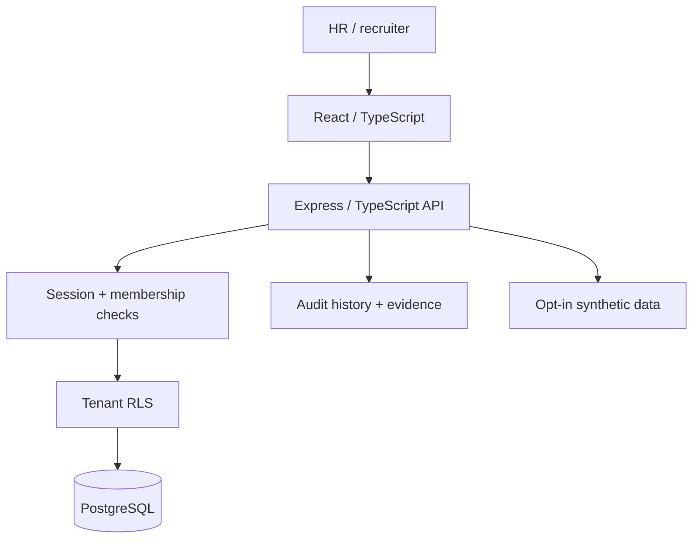

# CABO Human Capital — Engineering Case Study

**Status:** Active development / demonstration; not approved for genuine candidate or employee information.

## Product design

Recruitment and people operations need traceable human decisions, evidence provenance and authorised access instead of opaque scoring.

## Deep dive

**Recruitment:** The main README documents vacancy lifecycle, candidate stages, provenance for claims, human-authored outcome reasons and interview scorecards. Manually entered evidence must not be represented as independently verified.

**Isolation:** Tenant membership and PostgreSQL row-level security are described. Cross-organisation platform administration is a distinct privilege boundary.

**People operations:** Employee onboarding, leave approvals, reviews and development plans are in scope, but this is not complete payroll or fully verified labour-law compliance.

**Demonstration:** Synthetic demo records are intentionally labelled and opt-in; real candidates require a privacy assessment and operational security review before use.

## Verified script inventory

From root `package.json`:

| Goal | Script |
|---|---|
| Build frontend and API | `npm run build` |
| Type-check both | `npm run typecheck` |
| Build API and run tests | `npm test` |
| Apply migrations | `npm run db:migrate` |

These commands were inspected, **not executed** during this documentation update.

## Visual walkthrough plan

Use fictional data to capture vacancy board, applicant pipeline, human evidence review and audit log. Do not publish personal information or infer real outcomes from synthetic views.

**Open requirements:** Verify production deployment, enforcement of administrative MFA, privacy controls, identity checks and regulatory requirements.

[Back to README](../README.md) · [Architecture](architecture.md) · [Roadmap](roadmap.md)
