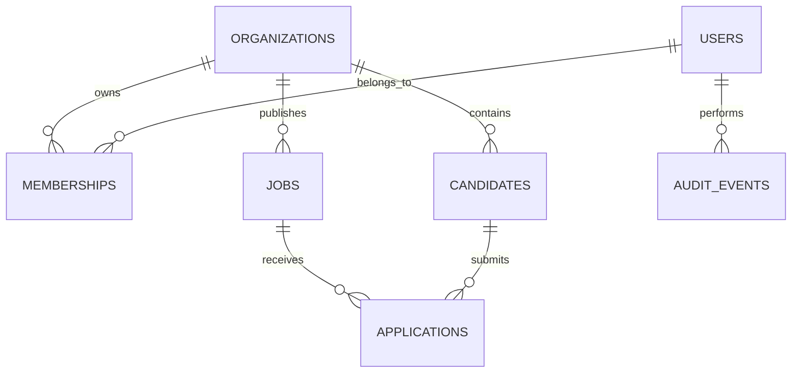

# CABO Human Capital — Phase 1 architecture

## Delivery boundary
Web: React/Vite UI in `apps/web`, served by Node/Express in production.
API: `apps/api`, HTTP JSON API versioned under `/api/v1`.
Data: **Neon PostgreSQL**, with SQL migrations in `db/migrations`.
Hosting: **Render web service** (single public host for app and API). No Render Postgres and no Railway.
Future native apps consume the same API and use Flutter native UI; they are not currently implemented.

## Threat model / trust boundaries
- The browser is untrusted. All mutations require authenticated, authorized API handlers.
- A signed, expiring, HttpOnly SameSite cookie identifies the user and organization. Roles are loaded from the database on every authorized request.
- PostgreSQL RLS is enabled and forced for each tenant-owned table. Each authorized action uses `BEGIN`, transaction-local `app.tenant_id` + `app.user_id`, and `COMMIT/ROLLBACK`. Tenant context does not leak through Neon pooling.
- Audit events are append-only via application code and are not editable from the API. Independent immutable logs and stronger database role separation remain production-hardening work.
- A separate, high-entropy `BOOTSTRAP_TOKEN` enables an **at-most-once** initial owner setup; unset it after provisioning.
- CV uploads, AI, employment records, payroll integrations, MFA, SSO and candidate self-service are **not yet implemented**.
- Tenant row policy testing against the Neon application role, security review and privacy/legal signoff are **required before production personal data**.

## Entity relationships

## Tenancy design
Every operational table has `tenant_id` and enforced RLS. The `applications` composite foreign keys also prevent linking another tenant's job or candidate. The global `users` table is not directly exposed; the login endpoint only verifies credentials. Membership discovery is restricted through a per-user session context.

## API summary
| Route | Roles | Effect |
|---|---|---|
| GET /health | Public | Database connectivity probe |
| POST /api/v1/setup | One-time setup token | Creates initial organization and owner |
| POST /api/v1/auth/login | Credentials | Secure signed session |
| POST /api/v1/auth/logout | Anyone | Clears session |
| GET /api/v1/auth/me | Member | Session and organization |
| GET /api/v1/overview | Member | SQL counts |
| GET, POST /api/v1/jobs | Member, editor respectively | Recruiter vacancies |
| PATCH /api/v1/jobs/:id/status | Editor | Publish / close role |
| GET, POST /api/v1/candidates | Member, editor respectively | Candidate directory |
| GET, POST /api/v1/applications | Member, editor respectively | Applications |
| PATCH /api/v1/applications/:id/stage | Editor | Recorded human stage transition |
| GET /api/v1/audit | Owner, HR admin | Audit events |

Editor = owner, HR admin, recruiter. Viewer is read-only.

## Explicit limitations
This is a functional **foundation**, not an enterprise-ready HRIS. No official POPIA, EEA, SOC 2 or ISO certification claims are made. Real hiring data must not be loaded until permissions, retention, consent, backups, RLS tests, CSRF hardening, monitoring and legal reviews are validated.
